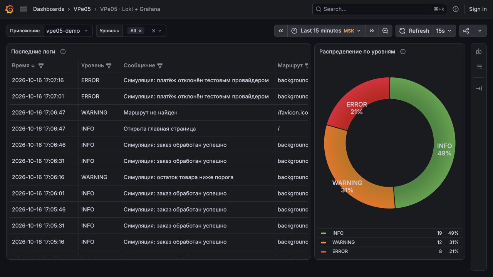

# VPe05. Мониторинг и логирование: Loki + Grafana

В Docker Compose работают Loki, Grafana и демонстрационное приложение.

- Источник данных Grafana: `http://loki:3100`.
- Дашборд: таблица логов и круговая диаграмма по уровням INFO, WARNING, ERROR; фильтр уровня, выбор периода и автообновление.
- Функция `send_log_to_loki` в `app.py` отправляет сообщения через `POST /loki/api/v1/push`.

## Запуск

Нужны Docker Compose и Python 3.

```bash
python3 scripts/init_env.py
docker compose up -d --build
```

Источник и дашборд создаются автоматически. Пароль администратора записан в `.env`.

## Результат

- [Grafana](http://159.194.202.109:3000/d/vpe05-logs/vpe05-loki-grafana) — просмотр без входа.
- [Приложение](http://159.194.202.109:18085/) — маршруты `/api/info`, `/api/warning`, `/api/error` создают события соответствующих уровней.
- [Подключение источника](docs/datasource.jpg).


